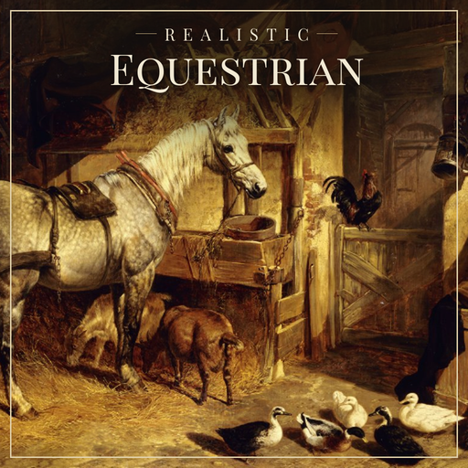

  

**Give your horses a career.** Every horse gets four competition stats that you build up by riding, feeding and breeding. Then enter them in shows, races and championships for prize money, from local novice classes to a Grand Prix on the other side of the world.

**You're the breeder, owner and trainer as well as the jockey.** You breed, buy, train and feed champion horses at home, then send them off to compete while you get on with the farm. The results and prize money come back to you - or host your own events and ride in them.

An add-on for Realistic Livestock - Ritter version (required), using its genetics, health and fitness.

Version 1.0, beta release. Back up your savegame first. Multiplayer is limited for now.

**Features**
**Four stats per horse:** Stamina, Speed, Agility and Temperament, each with an inherited potential and a unique method of training. No horse can max all four.
Competitions tab in RLRM's menu (Shift+O): show jumping, dressage, cross country, eventing, flat racing and steeplechase, across five levels and venues in four regions. Going and weather matter and you get a report on how each of your horses performed.
**Host your own events:** Build your own Showjumping and Dressage arenas and Cross Country courses and host different sizes of events with entry fees, spectator fees. You can even try and win the prize money yourself from the saddle.
**Event Sponsorship:** Events are expensive but you can get detailed sponsorship contracts from most FS manufacturers. Meet their terms and gain some great perks.
**Horse buildings:** riding halls, arenas, jump courses and round pens speed up training. Supports popular building mods and map scenery.
**Over 15 Dynamic Equestrian Obstacles:** Poles that are knocked down, eventing obstacles that don't clutter up your farm outside of events. Colors can be customized.
Training by riding: each stat is trained via its own minigame. Also works with the game's new Animal Workers: their daily ride (and RLRM's herdsman) keeps horses ticking over when you've got other things to do.
**Breeding that matters:** foals inherit potential from both parents, so champions take generations.
Feed boosts: oats, barley and corn boost different stats, and carrots and apples help temperament.
Risk and injuries: falls, refusals and rare injuries with real vet bills and rest.

## Requirements

**Required**

- Farming Simulator 25
- [Realistic Livestock - Ritter version](https://github.com/rittermod/FS25_RealisticLivestockRM)
  (`FS25_RealisticLivestockRM`). Without it the mod stays switched off.

**Strongly recommended**

- [Riding Hall 2k26](https://www.farming-simulator.com/mod.php?mod_id=355999&title=fs2025)
  (`FS25_RidingHall`): a riding hall and show jumps you can buy and place anywhere. Clearing
  them trains more agility than jumping fences or bales.

- [Showroom Displays] https://jasta007.itch.io/showroom-displays
Adds more sponsorship decoration options that work with Realistic Equestrian
  

**Recommended, not required**

These add horse buildings that speed up training. The mod works fine without them.

- [Rudolf Hoermann Equestrian Pack](https://www.farming-simulator.com/mod.php?mod_id=309997&title=fs2025)
  (`FS25_horsePack`): riding hall, outdoor training area and L barn
- [Riding Stable](https://www.farming-simulator.com/mod.php?mod_id=320241&title=fs2025)
  (`FS25_RidingStable`): a full riding centre

## Installation

1. Download `FS25_RealisticEquestrian.zip` from the releases page.
2. Copy the zip **as it is, without unzipping it**, into your mods folder:
   - Windows: `Documents\My Games\FarmingSimulator2025\mods`
   - macOS: `~/Library/Application Support/FarmingSimulator2025/mods`
3. Make sure `FS25_RealisticLivestockRM.zip` is in the same folder.
4. If you tried an earlier build, delete any old `FS25_RealisticEquestrian` folder or extra copies
   of the zip, so the game loads only one.
5. Start the game and enable both mods on your savegame. It works on new and existing saves:
   horses you already own get stats the first time the mod sees them.

To update, replace the zip with the new one. Your horses' stats are kept in your savegame.

## Getting started

Welcome popups walk you through the basics the first time you meet a horse and open each tab;
**Help popups: Show again** on the Equestrian settings tab replays them.

1. **Get a horse.** Use one you own or buy one from the animal dealer.
2. **Have a look at it.** Press **Shift+O** to open RLRM's menu. Under Genetics
   you'll see its **Skill potential** and current **Skills**.
3. **Ride it.** Pick it on the Info tab and press **Ride horse**, or walk up to it. Press **Y**
   for the Stamina or Speed view and follow the tips. The horse is done for the day when the panel
   says "Riding bar full".
   Put oats, barley, corn, carrots or apples in the trough to train faster.
4. **Enter an event.** Open the **Competitions** tab in the same menu, pick an event and a
   horse, then choose Auto or Manual Transport.
5. **Get your result** at the start of the next day or month, with prize money for the top three.
   Every event starts with an easy temperament check to get the horse to the start (only a very
   fractious horse fails it and is scratched). Each run is then a handful of stat checks (a show jumping round asks for agility at fences that
   get harder, a little speed and a calm horse), and the result says how it went: a clear round,
   a pole at the hardest fence, a refusal, or a course that was too big. The Competitions tab's
   **Results** page shows each horse's last five events, with who filled the top three, what it
   learned and any injury; a result line in RLRM's Messages tab opens it with **View results**.

## Compatibility

- **Maps:** any map with horses. Event venues are named after FS25 maps, but none of them need
  to be installed.
- **Crop mods:** apples from Orchards And Greenhouses (`APPLE`) and the Geistal map (`APPLE_GT`)
  work automatically. Other crops can be added in `data/feeds.xml`.
- **Building mods and maps:** the recommended mods above are recognised, plus some map scenery.
  Other riding halls and arenas may be picked up by name. More can be added in
  `data/facilities.xml`.
- **Other animals:** cows, pigs, sheep and the rest are not changed. RLRM's Meat Quality is hidden
  for horses only.
- **Other horse or animal mods** that replace RLRM's horse handling have not been tested.

## Known issues

- **Multiplayer is limited.** Competitions, entries and delivery work in single player and for
  the host of a multiplayer game. Other players see a note on the Competitions tab instead.
  Full multiplayer support is planned.
- **Beta release.** Bug reports with your
  `log.txt` are very welcome (see below).

## Reporting a bug

Play until the problem happens, quit the game, then send `log.txt` from
`C:\Users\<your name>\Documents\My Games\FarmingSimulator2025\`. Post it on the
[itch.io community board](https://jasta007.itch.io/realistic-equestrian/community) or open a
[GitHub issue](https://github.com/jasta007/fs25_realisticequestrian/issues/new/choose), and say
which mod version, map and other mods you use.

## Planned features

- Rival horses for sale (the named rivals already turn up in the same events)
- Stud missions: deliver a stallion of a set standard to the dealer for a fee
- More ways to earn, such as pony rides and riding lessons
- Full multiplayer support

## Console commands

Turn on the developer console to use these (open it with the tilde key). None are needed to play.

| Command | What it does |
| --- | --- |
| `eqSettings` | Shows the settings. `eqSettings cadence day\|month` sets how often round events run, plus `racing on\|off`, `injuries on\|off`, `forcedRetirement on\|off`, `entriesPerMonth <n>` (0 = no limit) and `trainingRate <x>` (1 = normal). The same settings are on the Settings page |
| `eqTraining` | Each horse's training focus and today's riding |
| `eqFocus <horse> <focus>` | Sets a horse's role: `balanced` (no role), `showJumping`, `dressage`, `crossCountry`, `eventing`, `racing`, `breeding` or `sale` |
| `eqStaff` | Your staff and the candidates on offer; `eqStaffHire <#>`, `eqStaffFire <#>`, `eqStaffWork <#> <general\|role\|horse>` |
| `eqFeed` | Horse food groups and each horse's feed boost |
| `eqFacilities` | Your horse buildings and what they give |
| `eqEvents`, `eqEnter`, `eqResults` | Lists, enters and shows results of events, as the Competitions tab does |
| `eqRatings [horse]` | Ratings in each discipline, experience, favourite event and career |
| `eqRetire <horse> [undo]` | Retires a horse from competition, or brings it back |
| `eqCourses [delete <number>]` | Lists your show jumping courses, or deletes one |

Testing commands, for checking the mod works rather than for play:

| Command | What it does |
| --- | --- |
| `eqForceInjury on\|off` | Every horse that starts an event is injured, even with injuries off. Not saved |
| `eqDirt <horse> <0-100>` | Sets a horse's dirt (0 = spotless; Cleanliness is 100 minus dirt). 10 or less at the day's end counts as groomed |
| `eqRiding <horse> [0-100]` | Sets a horse's riding bar (0 when left out, a fresh bar for the day). Training stops at 100 |
| `eqChanges <horse> [days]` | What changed the horse's four stats and why (your riding, staff, feed, facilities, age, fading, events, injuries), for today and yesterday or the last few days. Kept for a week, starts again on reload. Also shows the change since the horse joined your farm |

## A note on AI

Generative AI is a hot topic right now. I should know: I've been a game designer for 20 years
and I just got laid off, mostly because AI development is the biggest thing to happen in coding
since the compiler was invented, and it is turning the industry completely upside down.

I could be bitter about it and try to fight the inevitable, or I could use it to make awesome
stuff that I want to play. I chose the latter. I will only use AI where I think it's valuable,
gives good results and doesn't rip anyone off directly. If you are completely anti-AI, that's
fair, and this isn't the mod for you. If not, maybe give it a try. I'm happy to take any
suggestions where you feel I might not be giving anyone their fair dues for their hard work.

James

## Credits and licence

- **Author:** James ([jasta007](https://github.com/jasta007))
- Code written with [Claude Code](https://claude.com/claude-code), Anthropic's AI coding
  assistant, to my design and in-game testing (see [A note on AI](#a-note-on-ai)).
- Built on [Realistic Livestock - Ritter version](https://github.com/rittermod/FS25_RealisticLivestockRM)
  by Ritter, itself based on Arrow-kb's Realistic Livestock. No RLRM files are changed.
- Icon: John Frederick Herring Senior, *The Interior of a Stable with a Dapple Grey Horse in
  Harness* (1843), public domain. Lettering in Playfair Display SC (SIL Open Font License).
- Staff portraits: [kawsar4404](https://depositphotos.com/portfolio-41609378.html) on
  Depositphotos, licensed for this mod.
- Top hat and riding boots: royalty-free store models, licensed for this mod (resized and
  converted).

Licensed under [CC BY-NC-SA 4.0](LICENSE). You can share and change the mod, as long as you
credit the original, keep your version under the same licence, and don't sell it or use it
commercially. The staff portraits (`gui/eqStaffFaces.dds`) are licensed stock art and not
covered by that licence: don't reuse them outside this mod. The same goes for the top hat
and riding boots (`data/attire/topHat.i3d`, `data/attire/shortTopHat.i3d`, `data/attire/ridingBoots*`).

Want to help or build your own copy? See [CONTRIBUTING.md](CONTRIBUTING.md).
