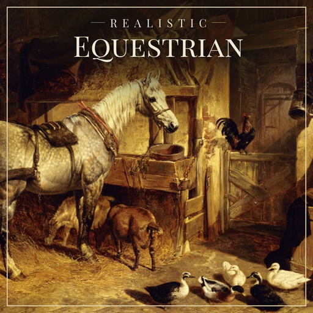

  

# Realistic Equestrian for Farming Simulator 25

> [!IMPORTANT]
> ## Press Shift+O to open your horses
> Everything this mod adds (your horses' stats, training and the **Competitions** tab) is in
> RLRM's menu, which opens with **Shift+O**. You can also get there from the game's Animals page
> (Esc > Animals): pick your horse stable and press **R** (Manage Animals).

**Give your horses a career.** Every horse gets four competition stats that you build up by
riding, feeding and breeding. Then enter them in shows, races and championships for prize money,
from local novice classes to a Grand Prix on the other side of the world.

**You're the breeder, owner and trainer, not the jockey.** You don't ride in the events yourself.
Your job is to breed, buy, train and feed champion horses at home, then send them off to compete.
The events run while you get on with the farm, and the results and prize money come back to you.

Realistic Equestrian is an add-on for
[Realistic Livestock - Ritter version](https://github.com/rittermod/FS25_RealisticLivestockRM) and
uses its genetics, health and fitness.

> **Version 0.1: early release.** Back up your savegame before trying it. Multiplayer is not
> fully supported yet (see [Known issues](#known-issues)).

## Contents

- [Features](#features)
- [Requirements](#requirements)
- [Installation](#installation)
- [Getting started](#getting-started)
- [Compatibility](#compatibility)
- [Known issues](#known-issues)
- [Planned features](#planned-features)
- [Console commands](#console-commands)
- [A note on AI](#a-note-on-ai)
- [Credits and licence](#credits-and-licence)

## Features

### Four stats per horse
- **Stamina, Speed, Agility and Temperament**, each with an inherited **potential** (how good the
  horse could become) and a trained **skill** (how good it is now).
- Potential is genetic and shown in RLRM's style (Average, High, Very high...). Skill runs from
  Untrained through Novice, Amateur, Competitor and Champion up to Legendary.
- No horse is perfect: the best can max one or two stats, never all four.
- Stats show in RLRM's menu (Shift+O) and in a Skills box when you look at a horse.

### Breeding that matters
- Foals inherit their stats' potential from both parents through RLRM's own breeding maths.
- Two great parents give a strong foal, not a guaranteed better one, so champions take
  generations.
- Horses already on your farm get believable starting stats for their age.

### Training
- **Ride your horses, and pick what to work on.** Stamina and speed train best from focused work,
  watched by an **Exertion** meter while you ride (it rises in canter and gallop and falls at
  slower gaits and at a halt):
  - **Stamina** comes from runs at canter or gallop. Canter 8 seconds without jumping or
    galloping to start stamina training; then the tempo multiplies it (up to x5,
    2.5 times the gains). Only the beat raises the tempo: when the middle of the screen says
    **Canter! (S)** or **Gallop! (W)**, press that key right then and exertion drops; three good
    beats (a perfect one counts double) raise the tempo. Pressing just too early wastes the beat,
    and a miss loses the progress to the next step; other keys are ignored. Timing tightens as
    the tempo climbs. Blowing hard (over 85% exertion) for 5 seconds or more than a couple of
    seconds below a canter breaks the tempo back to x1. Beats pause during a Sprint or a routine
    command.
  - **Speed** comes from fast gallops: gallop while the horse is fresh (exertion under 25%), then
    stand still to rest before the next one. Two good warm-up gallops warm the horse up; keep galloping
    and press **W** when **Sprint!** shows to run 25% faster, held on the limit just short of blowing
    hard (keep tapping W to spur it on; a slower horse runs out sooner), with
    three times the speed training. Then rest right down before warming up again.
  - One kind of training talks at a time, each in its own colour: a steady canter starts
    stamina (blue) until the tempo breaks, a cleared jump starts agility (green) until the combo
    ends, a warm-up gallop starts speed (orange) until the Sprint is over. Temperament (purple)
    routines always run. Only that training's popups and prompts show; the panel stays the same.
  - Jumping doesn't interrupt a run or a sprint: the pace from before take-off counts until
    shortly after landing, so you can jump an obstacle in the way.
  - A good session can give up to double what a full day of riding used to. Just riding round
    the gaits trains them at about a quarter of that.
  - **Agility** comes from jump combos: clear jumps one after another (fences, poles, anything
    solid) for x2 up to x5. You have 10 seconds to clear the next one; a trot is fine, but
    stopping, walking or backing up runs the clock down ten times as fast. A jump is judged
    once the horse has landed: hitting something or landing on it takes 3 seconds off the combo clock. Horses
    jump higher and stay in the air longer from a canter, and pick up speed faster, so a
    controlled canter approach can clear a fence.
  - **Temperament** comes from a routine: walk to start one, then do each movement asked for
    (walk, trot, stop, back up, turn left, turn right) within 3 seconds, for x2 up to x5. A
    canter, gallop, jump or a missed request breaks it. Steer freely: a turn request only needs
    the left or right key held for a moment, at any pace from backing up to a trot, and the
    other requests ignore steering. Requests show in the Freestyle and Temperament views.
- **Press Y while riding** to switch the training panel between **Freestyle** (the meter and a
  line for each stat) and the **Stamina**, **Speed**, **Agility** and **Temperament** views. Colours show how each is going.
  Help pops up at the bottom of the screen the first time you open each view; press **H**
  to see it again, and click anywhere to move on.
- **The riding bar is the horse's energy for the day.** Once it is full the horse is tired and
  trains no more until tomorrow, and galloping tires it fastest, so choose what to work on. A fit
  horse's bar fills more slowly (up to 1.4 times as long at stamina 100). Below 30% exertion a
  horse standing or walking recovers quickly, a fit one faster still.
- **Stats change how a horse rides.** Speed sets its top speed (about 10% slower than the base
  game at 10, 20% faster at 100); agility sets how high it jumps and how quickly it turns; a
  calm horse (temperament) changes pace a little quicker and stands less long after a knock.
  Canter jumps go higher than the base game's, so a horse can clear fences without a full gallop.
- **Works with the game's Animal Workers.** Turn on Riding for a horse pen (added to the base game
  in patch 1.25) and the workers' daily ride counts as training, as does RLRM's herdsman. They keep
  your horses ticking over towards a focus you choose, at half the rate of a full day of plain
  riding. Your own focused riding trains a stat up to four times as fast as staff, and only it
  takes a stat the last few points. A proper staff system of our own is planned (see
  [Planned features](#planned-features)).
- **Staff bring loose horses home.** A horse you ride and leave out in the world stays there
  overnight, unless you pay Animal Workers (Riding or Grooming) on one of your horse pens: when
  they do their round, they fetch your loose horses back to their own pen (or the nearest staffed
  pen with room) and look after them with the rest.
- Horses under two can only do light groundwork, so they train at 30% of the full rate, and
  two-year-olds at 60%. From three to twelve they train at full speed, then slow down again.
  Idle horses lose condition, and old horses slowly decline.
- RLRM's metabolism gene now matters: a fast-metabolism horse eats more, but riding builds its
  RLRM fitness (its condition on event day) up to 45% faster. A slow one is cheaper to keep but
  takes longer to get fit. It doesn't change how fast stats train.

### Feed
- What's in the trough speeds up training: oats, barley and corn boost different stats, and
  carrots and apples boost temperament. Boosts from different feeds add up.
- The pen's food list shows a row each for Oats, Barley, Corn, Hay and Treats, with the stats
  each boosts.
- Works with crops from other mods and maps: apples from
  [Orchards And Greenhouses](https://www.farming-simulator.com/mod.php?mod_id=346995&title=fs2025)
  and the [Geistal](https://www.farming-simulator.com/mod.php?mod_id=337082&title=fs2025) map,
  plus winter barley, winter wheat, alfalfa and clover. Feeds your map doesn't have are simply skipped.
- Sorghum is off the menu: it's toxic to horses.

### Horse buildings
- Owning a riding hall, outdoor arena, jump course or round pen speeds up training, and riding
  inside one speeds your riding up much more.
- They also give a small edge on the day in matching events (a jump course helps show jumping).
- Supports the Equestrian Pack, Riding Hall 2k26, Riding Stable and Horse Stable mods, and map
  scenery such as Elmcreek's show jumping course and the round roofed barn on Elmcreek and
  Frontier. Matching buildings say what they improve in the shop.

### Competitions
- A **Competitions tab** in RLRM's menu (Shift+O) lists the open events with their fee, prize
  money, level, going and injury risk, and rates each of your horses: Favourite, Contender,
  Outsider or Long shot.
- **Six disciplines:** show jumping, dressage, cross country, eventing, flat racing and the
  occasional steeplechase, each favouring different stats.
- **Five levels**, from Training and Novice classes every day (or month) to Advanced and Championship events
  each month at named venues across four regions. Young horse classes for two-year-olds teach
  rather than pay.
- **Conditions matter:** firm going favours speed, soft and heavy favour stamina, and hot weather
  tests stamina and temperament.
- **Event experience:** horses get better at the disciplines they compete in, and show a
  **Favourite event** such as "Show Jumping & Dressage", "3 Day Eventer" or "All Rounder".
- Every outing teaches a little, and limits on entries a month keep a good horse from being an
  endless money tap.

### Getting there
- **Auto Transport:** pay for a horse truck and the horse leaves straight away. Venues overseas or
  long-haul cost more, with quarantine.
- **Manual Transport:** save the transport fee and drive the horse to the animal dealer yourself.
  Horses waiting to go are marked **Awaiting delivery** in RLRM's lists. Drive the trailer into
  the dealer's loading area and open the dealer as usual: you're asked whether to deliver the
  waiting horses or open the dealer. **Left Shift + E** delivers too (rebindable in Controls).
- A horse away at an event leaves your pasture until its result comes in. RLRM still feeds and
  ages it.

### Risk, injuries and retirement
- Horses can be scratched, refuse, fall or be pulled up. Cross country and steeplechase are the
  riskiest, dressage the safest.
- Injuries are rare. The Events tab shows the risk for each event and for your chosen horse.
- An injury shows on the horse's **Diseases** page in Realistic Livestock, like any condition.
  Start treatment there to heal it sooner (the vet bills it as medicine), leave it untreated to
  heal for free but slowly, or cull. Each injury has its own trade-off: a bruised sole is a
  one-day $400 fix or a month of rest; a chip fracture is two months of surgery at $12,000 a
  month or a year off. Injuries never spread, and an injured horse can't be sold until it heals.
- **Retire** on that page (or `eqRetire`) cuts an injured horse's treatment fee by 60%.
- Events also bring a small chance of picking up one of Realistic Livestock's horse diseases
  (colic), more after a long trip. A sick horse can't be entered until it is better.
- With Realistic Livestock's diseases switched off, injuries are simply months of box rest.
- Keep horses well fed: under 50 health a horse may be scratched on the day (10% for every 5
  points under 50), at 25 or under it can't be entered, and poor health raises the injury risk.
  The Events tab shows the scratch chance.
- Pregnant mares stop competing, and you decide when a horse retires. Forced retirement after a
  serious injury is optional.

### Buying and selling
- The dealer sells horses of every quality, from ordinary hacks to the occasional championship
  prospect, priced on what they can do now and what they could become.
- **The dealer's word may be wrong.** Potential is shown as the dealer's view. After three months
  on your farm you find out whether you got a bargain or were misled.
- A good horse is an investment: expect a year or more of work before it pays its way.

### Settings
Realistic Livestock's Settings page (Shift+O, Settings) has an **Equestrian** tab next to General and Filters, saved with each savegame:
- **Training rate**: 0.25x to 3x the normal stat gain from riding, staff and events.
- **Show events**: round events every day or every month.
- **Races and steeplechases**: on or off.
- **Event injuries** and **Career-ending injuries**: on or off.
- **Entries per month**: how many event entries each farm can make (3 by default, or no limit).

In multiplayer only the host can change them for now.

For every rule and number, see [How Realistic Equestrian works](docs/MECHANICS.md).

## Requirements

**Required**

- Farming Simulator 25
- [Realistic Livestock - Ritter version](https://github.com/rittermod/FS25_RealisticLivestockRM)
  (`FS25_RealisticLivestockRM`). Without it the mod stays switched off.

**Recommended, not required**

These add horse buildings that speed up training. The mod works fine without them.

- [Rudolf Hoermann Equestrian Pack](https://www.farming-simulator.com/mod.php?mod_id=309997&title=fs2025)
  (`FS25_horsePack`): riding hall, outdoor training area and L barn
- [Riding Hall 2k26](https://www.farming-simulator.com/mod.php?mod_id=355999&title=fs2025)
  (`FS25_RidingHall`): riding hall and sellable show jumps
- [Riding Stable](https://www.farming-simulator.com/mod.php?mod_id=320241&title=fs2025)
  (`FS25_RidingStable`): a full riding centre

## Installation

1. Download `FS25_RealisticEquestrian.zip` from the releases page.
2. Copy the zip **as it is, without unzipping it**, into your mods folder:
   - Windows: `Documents\My Games\FarmingSimulator2025\mods`
   - macOS: `~/Library/Application Support/FarmingSimulator2025/mods`
3. Make sure `FS25_RealisticLivestockRM.zip` is in the same folder.
4. If you tried an earlier build, delete any old `FS25_RealisticEquestrian` folder or extra copies
   of the zip, so the game loads only one.
5. Start the game and enable both mods on your savegame. It works on new and existing saves:
   horses you already own get stats the first time the mod sees them.

To update, replace the zip with the new one. Your horses' stats are kept in your savegame.

## Getting started

1. **Get a horse.** Use one you own or buy one from the animal dealer.
2. **Have a look at it.** Press **Shift+O** to open RLRM's menu. Under Genetics
   you'll see its **Skill potential** and current **Skills**.
3. **Ride it.** Press **Y** for the Stamina or Speed view and follow the tips. The horse is done
   for the day when the panel says "Riding bar full".
   Put oats, barley, corn, carrots or apples in the trough to train faster.
4. **Enter an event.** Open the **Competitions** tab in the same menu, pick an event and a
   horse, then choose Auto or Manual Transport.
5. **Get your result** at the start of the next day or month, with prize money for the top three.

## Compatibility

- **Maps:** any map with horses. Event venues are named after FS25 maps, but none of them need
  to be installed.
- **Crop mods:** apples from Orchards And Greenhouses (`APPLE`) and the Geistal map (`APPLE_GT`)
  work automatically. Other crops can be added in `data/feeds.xml`.
- **Building mods and maps:** the recommended mods above are recognised, plus some map scenery.
  Other riding halls and arenas may be picked up by name. More can be added in
  `data/facilities.xml`.
- **Other animals:** cows, pigs, sheep and the rest are not changed. RLRM's Meat Quality is hidden
  for horses only.
- **Other horse or animal mods** that replace RLRM's horse handling have not been tested.

## Known issues

> [!WARNING]
> **RealisticLivestockRM​ is in a pretty fluid state right now dealing with the changes from Animal Staff.**
> Will probably need the latest Dev version and things might change quickly.

- **Multiplayer is limited.** Competitions, entries and delivery work in single player and for
  the host of a multiplayer game. Other players see a note on the Competitions tab instead.
  Full multiplayer support is planned.
- **Settings are console only.** There is no settings screen yet; see
  [Console commands](#console-commands).
- **Stats aren't on the game's own Animals screen.** It has room for only five rows and RLRM's
  horse rows take three. Use RLRM's menu (Shift+O) or look at the horse instead.
- **A horse away at an event isn't in your pasture**, so you can't see or ride it until its result
  is in. A horse delivered by Manual Transport needs a free place in one of your pastures.
- **Early release.** Most features have had little time in game yet. Bug reports with your
  `log.txt` are very welcome on the issues page.

## Planned features

- Rival horses with names that turn up in the same events, and sometimes come up for sale
- Stats that change how a horse rides: faster horses run faster and agile ones turn quicker
- Better staff, building on the game's Animal Workers: several hires and different kinds of staff
  (grooms, exercise riders, discipline trainers), including an expert who can tell you whether the
  dealer is overselling a horse
- Stud missions: deliver a stallion of a set standard to the dealer for a fee
- More ways to earn, such as pony rides and riding lessons
- Full multiplayer support
- A settings screen

## Console commands

Turn on the developer console to use these (open it with the tilde key). None are needed to play.

| Command | What it does |
| --- | --- |
| `eqSettings` | Shows the settings. `eqSettings cadence day\|month` sets how often round events run, plus `racing on\|off`, `injuries on\|off`, `forcedRetirement on\|off`, `entriesPerMonth <n>` (0 = no limit) and `trainingRate <x>` (1 = normal). The same settings are on the Settings page |
| `eqTraining` | Each horse's training focus and today's riding |
| `eqFocus <horse> <focus>` | Sets what staff train: `balanced`, `showJumping`, `dressage`, `crossCountry` or `racing` |
| `eqFeed` | Horse food groups and each horse's feed boost |
| `eqFacilities` | Your horse buildings and what they give |
| `eqEvents`, `eqEnter`, `eqResults` | Lists, enters and shows results of events, as the Competitions tab does |
| `eqRatings [horse]` | Ratings in each discipline, experience, favourite event and career |
| `eqRetire <horse> [undo]` | Retires a horse from competition, or brings it back |
| `eqMeatQuality show\|hide` | Shows or hides RLRM's Meat Quality for horses |

Testing commands, for checking the mod works rather than for play:

| Command | What it does |
| --- | --- |
| `eqForceInjury on\|off` | Every horse that starts an event is injured, even with injuries off. Not saved |
| `eqDirt <horse> <0-100>` | Sets a horse's dirt (0 = spotless; Cleanliness is 100 minus dirt). 10 or less at the day's end counts as groomed |
| `eqChanges <horse> [days]` | What changed the horse's four stats and why (your riding, staff, feed, facilities, age, fading, events, injuries), for today and yesterday or the last few days. Kept for a week, starts again on reload |

## A note on AI

Generative AI is a hot topic right now. I should know: I've been a game designer for 20 years
and I just got laid off, mostly because AI development is the biggest thing to happen in coding
since the compiler was invented, and it is turning the industry completely upside down.

I could be bitter about it and try to fight the inevitable, or I could use it to make awesome
stuff that I want to play. I chose the latter. I will only use AI where I think it's valuable,
gives good results and doesn't rip anyone off directly. If you are completely anti-AI, that's
fair, and this isn't the mod for you. If not, maybe give it a try. I'm happy to take any
suggestions where you feel I might not be giving anyone their fair dues for their hard work.

James

## Credits and licence

- **Author:** James ([jasta007](https://github.com/jasta007))
- Code written with [Claude Code](https://claude.com/claude-code), Anthropic's AI coding
  assistant, to my design and in-game testing (see [A note on AI](#a-note-on-ai)).
- Built on [Realistic Livestock - Ritter version](https://github.com/rittermod/FS25_RealisticLivestockRM)
  by Ritter, itself based on Arrow-kb's Realistic Livestock. No RLRM files are changed.
- Icon: John Frederick Herring Senior, *The Interior of a Stable with a Dapple Grey Horse in
  Harness* (1843), public domain. Lettering in Playfair Display SC (SIL Open Font License).

Licensed under [CC BY-NC-SA 4.0](LICENSE). You can share and change the mod, as long as you
credit the original, keep your version under the same licence, and don't sell it or use it
commercially.

Want to help or build your own copy? See [CONTRIBUTING.md](CONTRIBUTING.md).
